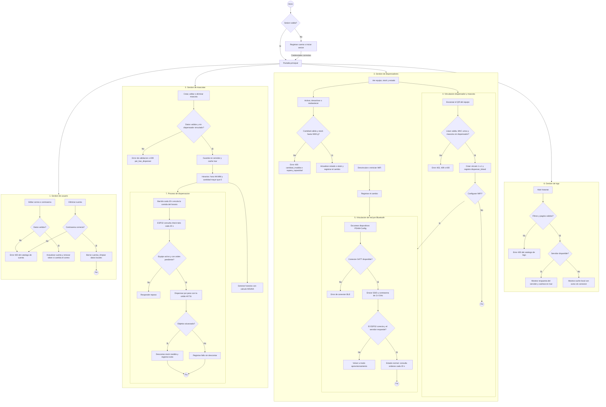

# Informe — Diagrama de flujo principal del sistema PDAM

## 1. Metadatos

| Campo | Valor |
|---|---|
| Fecha | 2026-10-30 |
| Subsistema | App (Flutter) + Backend (FastAPI) + Firmware (ESP32) |
| Alcance | Diagrama de flujo operativo resumido del sistema |
| Fuente | Código de `app/app_movil_pdam`, `api/app` y `DispensadorESP32/src` |
| Validación | Renderizado sin errores con `@mermaid-js/mermaid-cli` 12.0.0 |

> Diagrama resumido: cada proceso conserva su decisión principal y su validación
> crítica, sin el detalle de cada rama de error.

---

## 2. Diagrama

---

## 3. Trazabilidad por flujo

| Flujo | Regla principal |
|---|---|
| Usuario | Correo y contraseña válidos, renovación de token al cambiar el correo y baja con contraseña actual |
| Mascotas | Datos válidos, bloqueo del borrado con dispensador vinculado y horarios `HH:MM` con cantidad positiva |
| Dispensadores | Stock entre 0 y 5000 g, reabastecimiento idempotente y registro de cada cambio |
| Vinculación | Llave del QR, MAC única normalizada, relación 1 a 1 y transacción atómica |
| Bluetooth | Conexión GATT, credenciales de red 2.4 GHz y rollback a aprovisionamiento si falla |
| Logs | Filtros y paginación validados, caché local cuando el servidor no responde |
| Dispensación | Orden pendiente, equipo activo, objetivo alcanzado y descuento solo en caso exitoso |

---

## 4. Notas

1. `GET /dispensers/check-taks/{mac}` devuelve hoy una orden fija `serve=true` y `amount=50`; la rama describe la lógica de `order_service.entregar_orden`.
2. Los registros de actividad se escriben en la misma transacción que la operación que los origina.
3. El diagrama se validó con `@mermaid-js/mermaid-cli` 12.0.0 sin errores de sintaxis.
